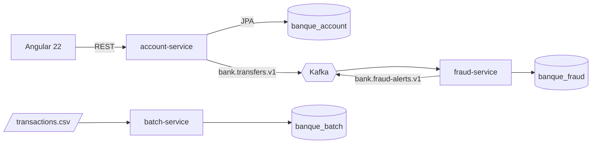
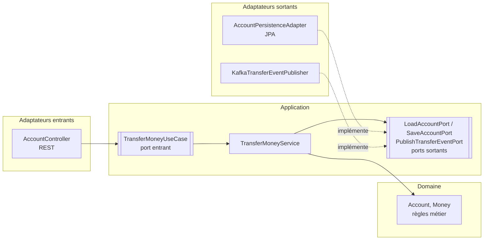

# 🏛️ Architecture de BanqueLab

## Le choix : microservices **et** hexagonal

Tu proposais trois options : oignon, hexagonal ou microservices. En réalité, elles ne s'opposent pas :

- **Microservices** = comment on **découpe le système** en plusieurs applications indépendantes (une par domaine métier).
- **Hexagonal** (ou *Ports & Adapters*) et **oignon** = comment on **organise le code à l'intérieur** d'une application. Ce sont deux variantes très proches de la même idée : protéger le métier des détails techniques.

La combinaison la plus fréquente dans les offres en banque et en ESN, c'est **des microservices dont chacun est écrit en hexagonal**. C'est donc ce qu'on fait ici.

**Règle des microservices :** chaque service possède **sa propre base**. Aucun service ne lit directement la base d'un autre : il passe par une API ou par Kafka.

## L'hexagone expliqué simplement

> 🧪 *Pour la testeuse : imagine une prise électrique. L'appareil (le **métier**) a une prise standard (le **port**). Selon le pays, on utilise un **adaptateur** différent, sans jamais modifier l'appareil. Ici, le métier « faire un virement » ne sait pas s'il est appelé par une page web, un batch ou un message Kafka, ni si les données sont dans PostgreSQL ou ailleurs.*

### Les packages de `account-service`

| Package | Contenu | Peut dépendre de |
|---|---|---|
| `domain.model`, `domain.exception` | Règles métier pures (`Account.withdraw` refuse un solde insuffisant) | **Rien** (ni Spring, ni JPA) |
| `application.port.in` | Ce que l'appli sait faire (`TransferMoneyUseCase`) | domaine |
| `application.port.out` | Ce dont l'appli a besoin (`LoadAccountPort`) | domaine |
| `application.service` | Orchestration des cas d'usage, transactions | domaine, ports |
| `adapter.in.web` | REST : JSON ↔ commandes | application |
| `adapter.out.persistence` | JPA : entités ↔ domaine | application (ports) |
| `adapter.out.messaging` | Kafka | application (ports) |
| `config` | Câblage Spring des beans | tout |

Ces règles sont **vérifiées automatiquement** par `HexagonalArchitectureTest` (ArchUnit). Si quelqu'un importe JPA dans le domaine, le build casse.

### Pourquoi c'est utile (concrètement)
1. **Tests faciles** : `AccountTest` teste le métier en quelques millisecondes, sans Spring. Les tests Cucumber remplacent Kafka par un mock en une ligne.
2. **Changer de techno sans toucher au métier** : passer de Kafka à RabbitMQ ne demande qu'un nouvel adaptateur.
3. **Lisibilité** : un nouvel arrivant trouve le métier dans `domain` et la technique dans `adapter`.

### Compromis assumés (à discuter en entretien)
- `@Transactional` est placé dans `application.service`. C'est une petite entorse à la pureté, acceptée par la plupart des équipes.
- L'entité JPA est séparée du modèle de domaine. C'est plus de code (le *mapping*), mais le domaine reste libre.
- Le modèle n'est pas un DDD complet (pas d'agrégats formalisés) : on pourra l'enrichir.
